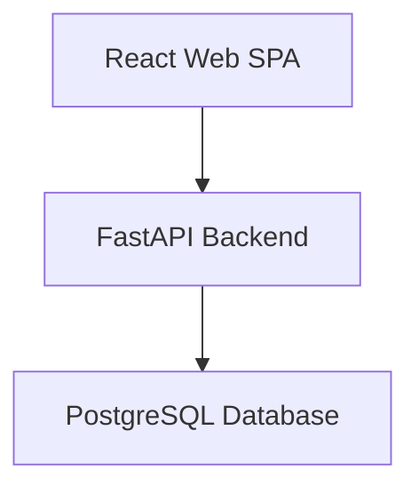
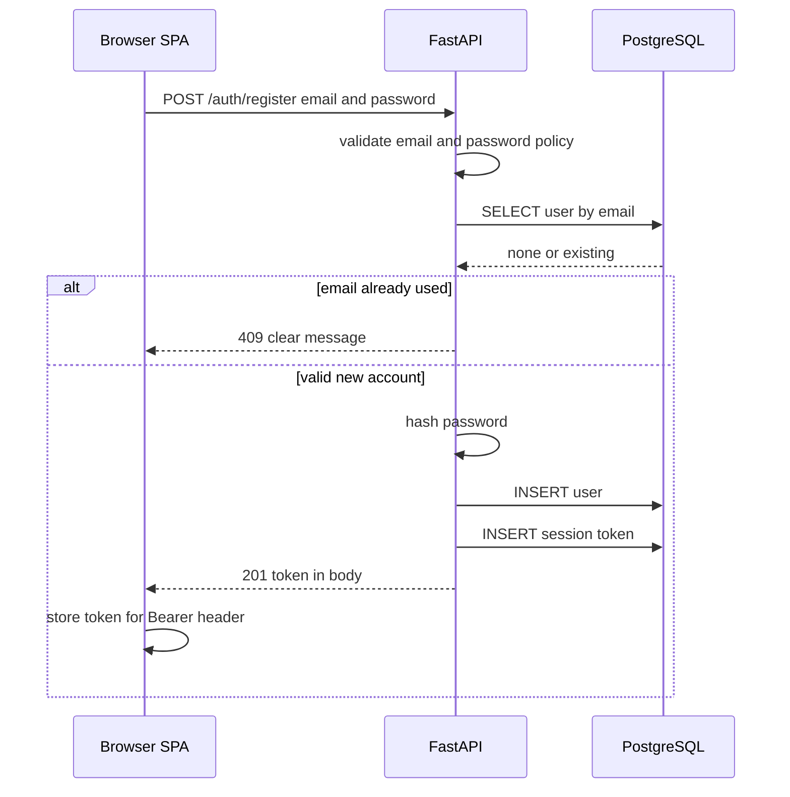
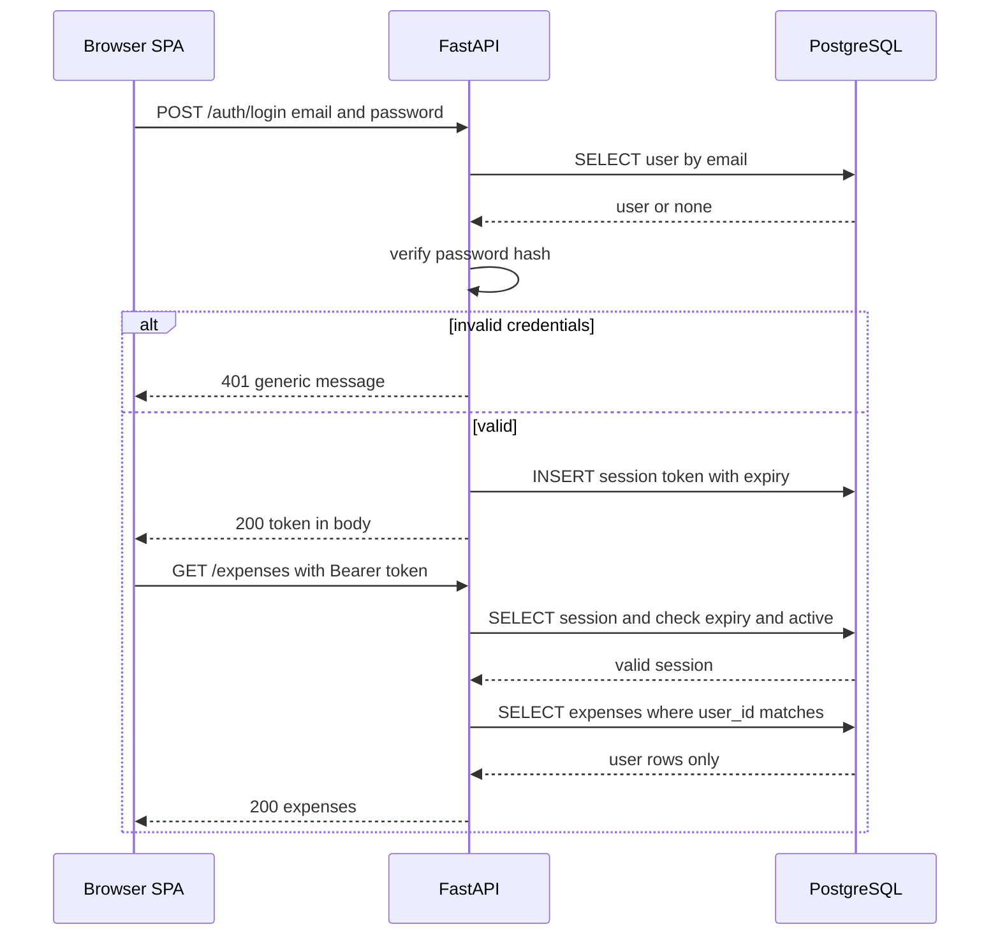
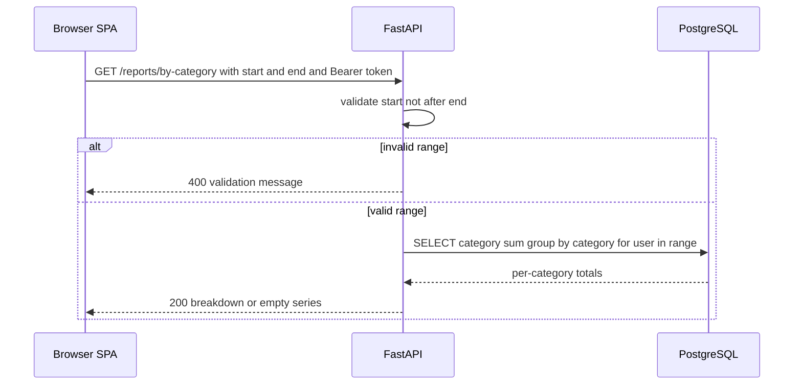
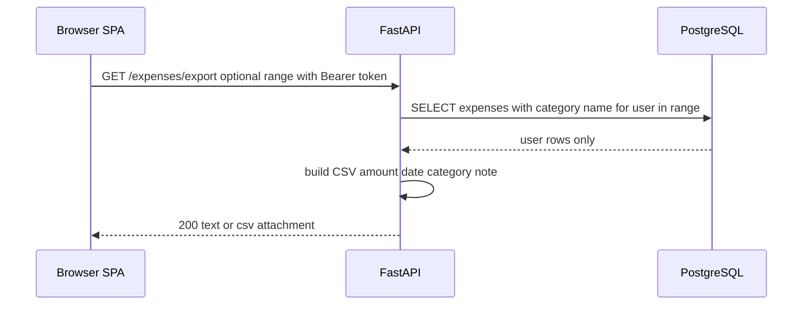
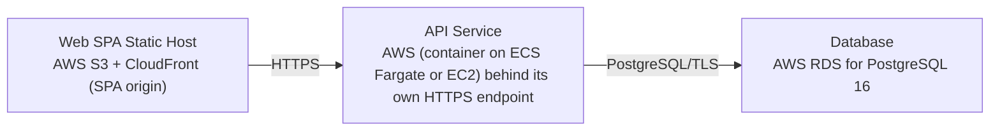

# Architecture

> Maintained by QuorQ AI SDLC. Text between `sdlc:auto` markers is regenerated; anything outside them is yours and is kept.

<!-- sdlc:auto:start narrative -->
## Overview

### ARCH-001 · approved · source: architecture:summary

Overall approved architecture: a React 19 SPA (own origin) calling a FastAPI 0.115 REST API (separate origin), backed by PostgreSQL 16, hosted on AWS. Users register/sign in with email+password and an opaque bearer session token; all expense/category data and reports are strictly scoped to the authenticated owner.

Approved, version 1. Scope included: registration/sign-in via server-side sessions with opaque bearer token; private per-user expense and category CRUD; dashboard summary; reports (spending-over-time and by-category) with date-range filtering; CSV export of expenses. Explicitly out of scope: email delivery, multi-currency, recurring expenses, receipt attachments, bank import, billing.

### ARCH-002 · approved · source: architecture:components:web_spa

React 19 single-page application providing the responsive browser UI for the whole app.

Responsive browser UI covering: registration, sign-in, expense and category CRUD, dashboard summary, reports with charts and date-range filtering, and a CSV export trigger. Stores the opaque session token client-side and sends it as an 'Authorization: Bearer' header on every API call. Reads the API base URL from the VITE_API_BASE_URL environment variable. Built as a Vite SPA served from its own origin, separate from the API's origin.

**Related:** ARCH-003

### ARCH-003 · approved · source: architecture:components:api_backend

FastAPI 0.115 REST API that implements all business logic: auth/session management, per-user expense and category CRUD, dashboard/report aggregates, and CSV export.

Responsibilities: auth (register, sign-in, sign-out, deactivate); server-side session issuance/validation/revocation using an opaque token; expense and category CRUD scoped to the authenticated user; dashboard aggregates; report queries (over-time and by-category) with date-range filters; CSV export. Validates amounts, dates and categories on input (via Pydantic).

**Related:** ARCH-002, ARCH-004, ARCH-010

### ARCH-004 · approved · source: architecture:components:database

PostgreSQL 16 relational store for users, sessions, categories and expenses.

Durable relational store enforcing per-user ownership via foreign keys. Performs date-range grouping and per-category aggregation for reports directly in SQL. Keeps monetary amounts exact using a numeric type (numeric(12,2) per the technology decision).

**Related:** ARCH-003, ARCH-009

### ARCH-005 · approved · source: architecture:critical_paths:register

Registration flow: a new visitor creates a private account with email and password.

A new visitor submits email and password. The backend validates email format and password rules, rejects a duplicate email, hashes the password, creates the user record, and either issues a session token directly or returns success and routes the user to the sign-in screen. Maps to endpoint POST /auth/register and the users entity.

**Related:** ARCH-003, ARCH-004

### ARCH-006 · approved · source: architecture:critical_paths:signin_auth

Sign-in and request authorization flow using an opaque bearer session token.

User signs in with email and password (POST /auth/login). On success, an opaque session token is returned in the response body and subsequently sent as a bearer header on later calls. Each protected request validates the token, checks its expiry/inactivity state and the account's active state, and scopes all returned data to that user. Maps to the sessions entity and GET /auth/me for session confirmation.

**Related:** ARCH-003, ARCH-004

### ARCH-007 · approved · source: architecture:critical_paths:reports

Reports flow: by-category and over-time spending with a user-selected date range.

User opens reports and selects a start and end date. The backend validates the date range, runs grouped aggregation queries scoped to the user, and returns a time-series for the chart plus totals per category. Empty ranges return an empty series, which the UI renders as an empty state. Maps to GET /reports/over-time and GET /reports/by-category.

**Related:** ARCH-003, ARCH-004

### ARCH-008 · approved · source: architecture:critical_paths:export_csv

CSV export flow: user downloads their own expenses, optionally filtered by date range.

User triggers an export of their expenses, optionally constrained to the currently selected date range. The backend streams a CSV built only from that user's own rows, with columns for amount, date, category and note. Maps to GET /expenses/export.

**Related:** ARCH-003

### ARCH-009 · approved · source: architecture:entities

Data model: four tables -- users, sessions, categories, expenses -- all owned per-user.

users: id, email, password_hash, is_active, created_at. sessions: id, user_id, token_hash, created_at, last_active_at, expires_at, revoked_at (supports opaque-token validation, expiry/inactivity checks and revocation). categories: id, user_id, name, created_at (unique name per user per the PostgreSQL technology decision). expenses: id, user_id, category_id, amount, spent_on, note, created_at, updated_at. Foreign keys enforce per-user ownership throughout.

**Related:** ARCH-004

### ARCH-010 · approved · source: architecture:endpoints

Full REST API surface: auth/session, account, categories, expenses, dashboard, reports and export.

Auth/session: POST /auth/register (create account, rejects duplicate/invalid email or password); POST /auth/login (returns opaque session token on success, generic failure message); POST /auth/logout (revokes token server-side); GET /auth/me (confirms session validity); POST /account/deactivate (deactivates account, revokes all sessions, blocks future sign-in). Categories: GET /categories (list own categories); POST /categories (create, non-blank name unique within account); PATCH /categories/{id} (rename, valid+unique); DELETE /categories/{id} (blocked with explanation if expenses are assigned). Expenses: GET /expenses (list, most recent first); POST /expenses (create, positive amount, date, one of user's categories, optional note); PATCH /expenses/{id} (edit amount/date/category/note); DELETE /expenses/{id} (delete after confirmation). Dashboard/reports: GET /dashboard/summary (current-period total and top categories); GET /reports/over-time (time-series, optional date range); GET /reports/by-category (per-category totals, optional date range). Export: GET /expenses/export (CSV with amount, date, category, note, optional date range).

**Related:** ARCH-003, ARCH-009

### ARCH-011 · approved · source: architecture:deployment_nodes

AWS deployment topology: static SPA hosting, a containerized API service, and managed PostgreSQL.

Web SPA Static Host: AWS S3 + CloudFront serving the static React 19 build as the SPA origin. API Service: containerized on AWS (ECS Fargate or EC2) behind its own HTTPS endpoint, running FastAPI 0.115 on Python 3.12 via Uvicorn. Database: AWS RDS for PostgreSQL 16. The SPA and API are deployed on separate origins/endpoints.

**Related:** ARCH-002, ARCH-003, ARCH-004

### ARCH-012 · approved · source: architecture:technology_decisions:frontend

Frontend stack decision: React 19, over Vue and Svelte alternatives.

Approved stack. Built as a Vite SPA served from its own origin; stores the opaque session token and renders interactive reports/charts that redraw live as the date-range filter changes, intended to feel instant on both desktop and mobile. Alternatives considered: Vue, Svelte.

**Related:** ARCH-002

### ARCH-013 · approved · source: architecture:technology_decisions:backend

Backend stack decision: FastAPI 0.115, over Django REST Framework and Flask alternatives.

Approved stack. Pydantic request validation keeps amounts, dates and categories clean for financial figures; dependency-injected session checks make per-user scoping and bearer-token auth straightforward. Alternatives considered: Django REST Framework, Flask.

**Related:** ARCH-003

### ARCH-014 · approved · source: architecture:technology_decisions:database

Database stack decision: PostgreSQL 16, over MySQL and SQLite alternatives.

Approved stack. numeric(12,2) keeps amounts exact to the cent; SQL grouping over a date range efficiently produces the over-time and by-category report figures per user; a unique (user_id, name) constraint enforces category uniqueness. Alternatives considered: MySQL, SQLite.

**Related:** ARCH-004, ARCH-009

### ARCH-015 · approved · source: architecture:technology_decisions:cloud

Cloud provider decision: AWS, over Google Cloud and Azure alternatives.

Approved stack. RDS for PostgreSQL gives managed backups and encryption for private finance data; the API runs as a container alongside an S3/CloudFront-hosted SPA on a separate origin. Alternatives considered: Google Cloud, Azure.

**Related:** ARCH-011
<!-- sdlc:auto:end narrative -->

<!-- sdlc:auto:start building-blocks -->
## Building Block View

| ID | Name | Technology | Responsibility | Depends on |
|---|---|---|---|---|
| web_spa | React Web SPA | React 19 | Responsive browser UI for registration, sign-in, expense and category CRUD, dashboard summary, reports with charts and date-range filtering, and CSV export trigger. Stores the opaque session token and sends it as Authorization: Bearer on every API call. Reads the API base URL from VITE_API_BASE_URL. | api_backend |
| api_backend | FastAPI Backend | FastAPI 0.115 | REST API for auth (register, sign-in, sign-out, deactivate), server-side session issuance/validation/revocation with an opaque token, expense and category CRUD scoped to the authenticated user, dashboard aggregates, report queries (over-time and by-category with date-range filters), and CSV export. Validates amounts, dates and categories on input. | database |
| database | PostgreSQL Database | PostgreSQL 16 | Durable relational store for users, sessions, categories and expenses. Enforces per-user ownership via foreign keys, performs date-range grouping and per-category aggregation for reports, and keeps monetary amounts exact with a numeric type. | — |

<!-- sdlc:auto:end building-blocks -->

<!-- sdlc:auto:start runtime -->
## Runtime View

### Register and start a private account

A new visitor submits email and password. The backend validates format and password rules, rejects a duplicate email, hashes the password, creates the user, and either issues a session token or returns success for the sign-in screen.

- **Components:** web_spa, api_backend, database
- **Modules:** auth_router, auth_service, password_hasher, user_repository
- **Key functions:** register(email, password), validate_password_policy(password), hash_password(password), create_user(email, password_hash), issue_session(user_id)

### Sign in and authorise protected requests

User signs in with email and password. On success an opaque session token is returned in the body and sent as a bearer header on later calls. Each protected request validates the token, checks expiry/inactivity and account active state, and scopes data to the user.

- **Components:** web_spa, api_backend, database
- **Modules:** auth_router, auth_service, session_middleware, user_repository
- **Key functions:** login(email, password), verify_password(password, password_hash), resolve_session(token), touch_session_activity(session_id), require_current_user(request)

### Reports: by-category and over-time with date range

User opens reports and selects a start and end date. The backend validates the range, runs grouped aggregation queries scoped to the user, and returns series for the time chart and totals per category. Empty ranges return an empty series for the UI empty state.

- **Components:** web_spa, api_backend, database
- **Modules:** reports_router, reports_service, expense_repository
- **Key functions:** validate_range(start, end), spending_over_time(user_id, start, end), spending_by_category(user_id, start, end)

### Export expenses as CSV

User exports their expenses, optionally within the selected date range. The backend streams a CSV built from the user's own rows with amount, date, category and note columns.

- **Components:** web_spa, api_backend, database
- **Modules:** export_router, export_service, expense_repository
- **Key functions:** export_expenses_csv(user_id, start, end), build_csv(rows)

<!-- sdlc:auto:end runtime -->

<!-- sdlc:auto:start deployment-view -->
## Deployment View

| Name | Service | Runtime | Scaling | Environment |
|---|---|---|---|---|
| Web SPA Static Host | AWS S3 + CloudFront (SPA origin) | Static React 19 build | CDN edge cached | dev |
| API Service | AWS (container on ECS Fargate or EC2) behind its own HTTPS endpoint | FastAPI 0.115 on Python 3.12 (Uvicorn) | 1 task for dev, horizontally scalable | dev |
| Database | AWS RDS for PostgreSQL 16 | PostgreSQL 16 | Single instance for dev with automated backups | dev |

| Source | Target | Protocol |
|---|---|---|
| Web SPA Static Host | API Service | HTTPS |
| API Service | Database | PostgreSQL/TLS |

<!-- sdlc:auto:end deployment-view -->

<!-- sdlc:auto:start decisions -->
## Architecture Decisions

| Layer | Choice | ADR |
|---|---|---|
| Frontend | React 19 | [ADR-0001](adr/frontend.md) |
| Backend | FastAPI 0.115 | [ADR-0002](adr/backend.md) |
| Database | PostgreSQL 16 | [ADR-0003](adr/database.md) |
| Cloud | AWS | [ADR-0004](adr/cloud.md) |
<!-- sdlc:auto:end decisions -->

<!-- sdlc:auto:start links -->
## Related Documents

- [Data Model](data-model.md)
- [API Specification](api/openapi.yaml)
- [Architecture Decision Records](adr/README.md)
<!-- sdlc:auto:end links -->
