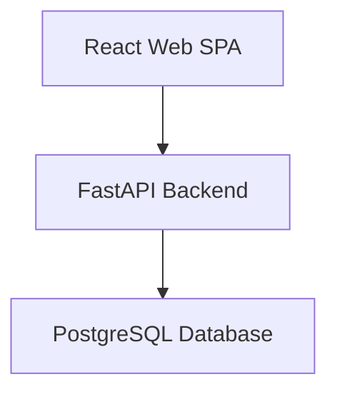
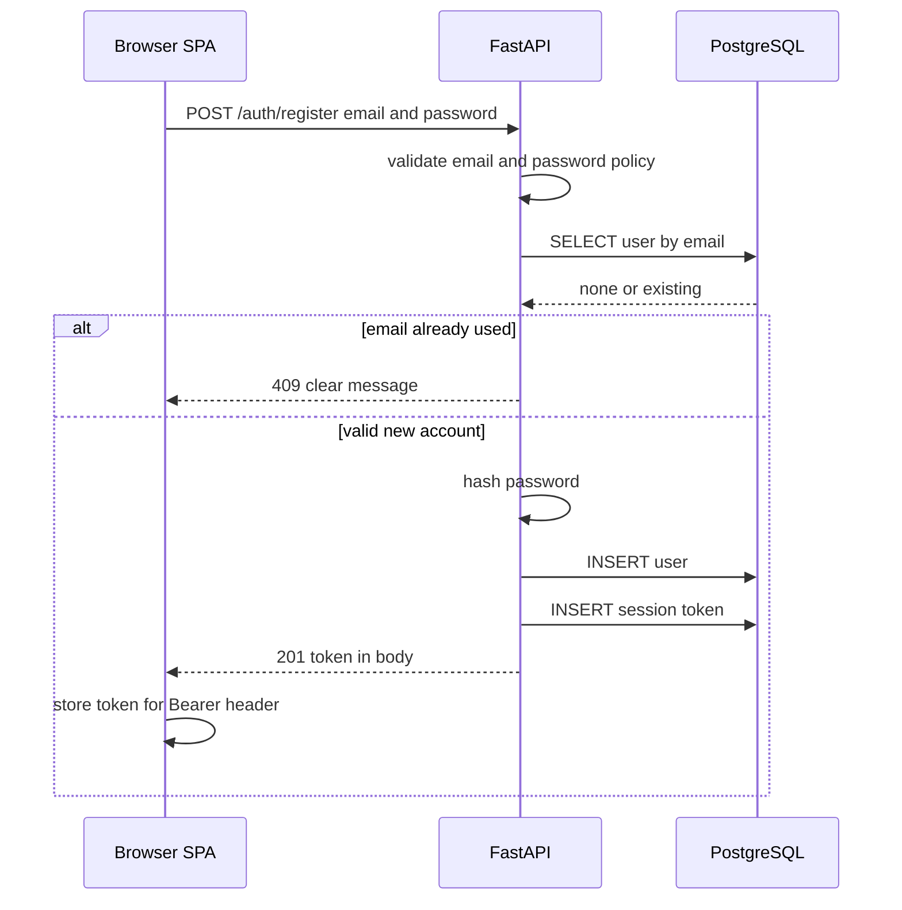
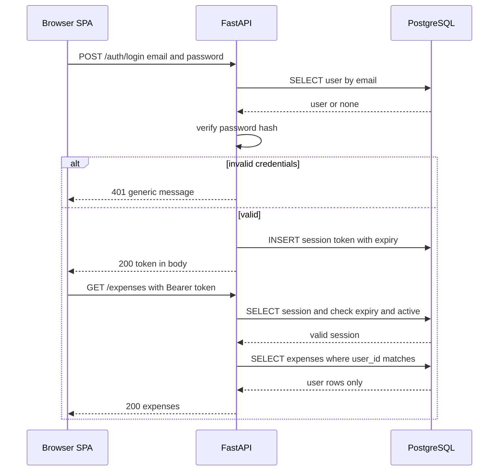
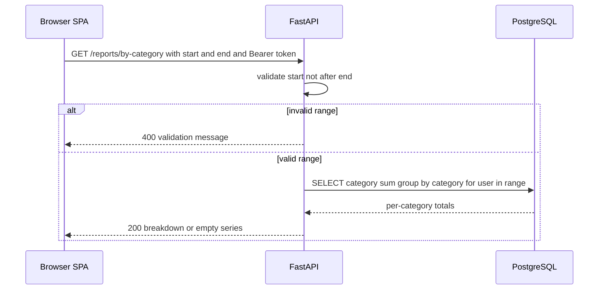
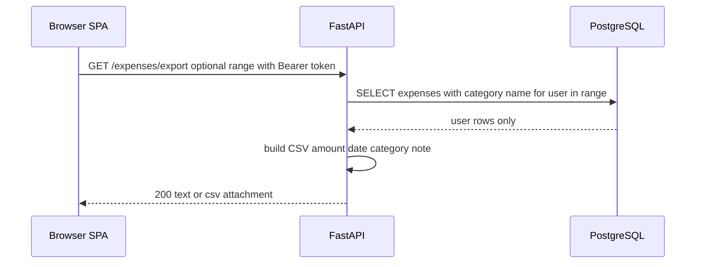
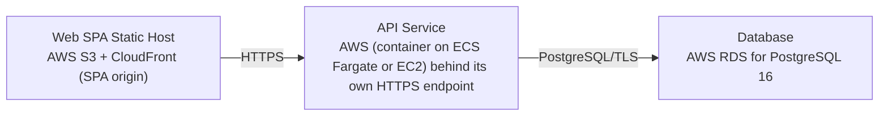

# Architecture

> Maintained by QuorQ AI SDLC. Text between `sdlc:auto` markers is regenerated; anything outside them is yours and is kept.

<!-- sdlc:auto:start narrative -->
## Overview

### ARCH-SUMMARY · approved · source: architecture:summary

Lightweight personal expense tracker: React 19 SPA (own origin) talking to a FastAPI 0.115 REST API (separate origin), backed by PostgreSQL 16, hosted on AWS.

Users register with email and password, sign in via server-side sessions identified by an opaque bearer token, and privately manage their own expenses and categories. Dashboard and reports compute per-user totals, spending-over-time and by-category breakdowns with date-range filtering; expenses can be exported to CSV. All data is strictly scoped to the authenticated owner. No email delivery, multi-currency, recurring expenses, receipt attachments, bank import or billing are included, per the out-of-scope list.

**Related:** REQ-STACK, REQ-SCOPE

### ARCH-COMP-WEB · approved · source: architecture:component:web_spa

React Web SPA (React 19): the responsive browser UI for the whole app.

Responsive browser UI for registration, sign-in, expense and category CRUD, dashboard summary, reports with charts and date-range filtering, and CSV export trigger. Stores the opaque session token and sends it as Authorization: Bearer on every API call. Reads the API base URL from VITE_API_BASE_URL.

**Related:** REQ-FEAT-SIGNIN, REQ-FEAT-EXPENSES, REQ-FEAT-CATEGORIES, REQ-FEAT-DASHBOARD, REQ-FEAT-REPORTS

### ARCH-COMP-API · approved · source: architecture:component:api_backend

FastAPI Backend (FastAPI 0.115): the REST API for auth, data CRUD, dashboard/report aggregation and CSV export.

Provides auth (register, sign-in, sign-out, deactivate), server-side session issuance/validation/revocation with an opaque token, expense and category CRUD scoped to the authenticated user, dashboard aggregates, report queries (over-time and by-category with date-range filters), and CSV export. Validates amounts, dates and categories on input.

**Related:** REQ-FEAT-SIGNIN, REQ-FEAT-EXPENSES, REQ-FEAT-CATEGORIES, REQ-FEAT-DASHBOARD, REQ-FEAT-REPORTS, REQ-FEAT-PLATFORM

### ARCH-COMP-DB · approved · source: architecture:component:database

PostgreSQL Database (PostgreSQL 16): durable relational store for users, sessions, categories and expenses.

Enforces per-user ownership via foreign keys, performs date-range grouping and per-category aggregation for reports, and keeps monetary amounts exact with a numeric type.

**Related:** REQ-STACK

### ARCH-CP-REGISTER · approved · source: architecture:critical-path:register

Critical path: register and start a private account.

A new visitor submits email and password. The backend validates format and password rules, rejects a duplicate email, hashes the password, creates the user, and either issues a session token or returns success for the sign-in screen.

**Related:** ARCH-COMP-API, ARCH-COMP-DB, REQ-FEAT-SIGNIN

### ARCH-CP-SIGNIN · approved · source: architecture:critical-path:signin

Critical path: sign in and authorise protected requests.

User signs in with email and password. On success an opaque session token is returned in the body and sent as a bearer header on later calls. Each protected request validates the token, checks expiry/inactivity and account active state, and scopes data to the user.

**Related:** ARCH-COMP-API, REQ-FEAT-SIGNIN

### ARCH-CP-REPORTS · approved · source: architecture:critical-path:reports

Critical path: reports by-category and over-time with date range.

User opens reports and selects a start and end date. The backend validates the range, runs grouped aggregation queries scoped to the user, and returns series for the time chart and totals per category. Empty ranges return an empty series for the UI empty state.

**Related:** ARCH-COMP-API, ARCH-COMP-DB, REQ-FEAT-REPORTS

### ARCH-CP-EXPORT · approved · source: architecture:critical-path:export

Critical path: export expenses as CSV.

User exports their expenses, optionally within the selected date range. The backend streams a CSV built from the user's own rows with amount, date, category and note columns.

**Related:** ARCH-COMP-API, REQ-FEAT-REPORTS

### ARCH-ENTITIES · approved · source: architecture:entities

Core data model: users, sessions, categories, expenses.

- users: id, email, password_hash, is_active, created_at.
- sessions: id, user_id, token_hash, created_at, last_active_at, expires_at, revoked_at.
- categories: id, user_id, name, created_at.
- expenses: id, user_id, category_id, amount, spent_on, note, created_at, updated_at.

**Related:** ARCH-COMP-DB

### ARCH-ENDPOINTS · approved · source: architecture:endpoints

REST API surface: auth, account, categories, expenses, dashboard, reports and export.

- POST /auth/register - create account; rejects duplicate email and invalid email/password.
- POST /auth/login - sign in; returns opaque session token on success, generic message on failure.
- POST /auth/logout - end current session immediately (revoke token server-side).
- GET /auth/me - return current authenticated user, confirms session validity.
- POST /account/deactivate - deactivate account, revoke all sessions, block future sign-in.
- GET /categories - list the user's categories.
- POST /categories - create category (non-blank, unique name).
- PATCH /categories/{id} - rename category to a valid, unique name.
- DELETE /categories/{id} - delete category only if no expenses assigned; otherwise blocked with explanation.
- GET /expenses - list user's expenses, most recent first.
- POST /expenses - create expense (positive amount, date, user's category, optional note).
- PATCH /expenses/{id} - edit amount, date, category or note.
- DELETE /expenses/{id} - delete after confirmation.
- GET /dashboard/summary - current-period total and top categories from user's own data.
- GET /reports/over-time - time-series of total spending, optional date range.
- GET /reports/by-category - per-category totals, optional date range.
- GET /expenses/export - export user's expenses (optionally date-ranged) as CSV with amount, date, category, note columns.

**Related:** ARCH-COMP-API, ARCH-ENTITIES

### ARCH-DEPLOY · approved · source: architecture:deployment-nodes

Three deployment nodes: static SPA host, containerized API service, and managed Postgres database, all on AWS.

- Web SPA Static Host: AWS S3 + CloudFront (SPA origin), static React 19 build.
- API Service: AWS (container on ECS Fargate or EC2) behind its own HTTPS endpoint, FastAPI 0.115 on Python 3.12 (Uvicorn).
- Database: AWS RDS for PostgreSQL 16, PostgreSQL 16.

**Related:** ARCH-COMP-WEB, ARCH-COMP-API, ARCH-COMP-DB

### ARCH-TECH-FRONTEND · approved · source: architecture:technology-decision:frontend

Frontend: React 19 approved over Vue/Svelte alternatives.

Built as a Vite SPA served from its own origin; stores the opaque session token and renders interactive reports/charts that redraw live as the date-range filter changes, feeling instant on desktop and mobile.

**Related:** ARCH-COMP-WEB, REQ-STACK

### ARCH-TECH-BACKEND · approved · source: architecture:technology-decision:backend

Backend: FastAPI 0.115 approved over Django REST Framework/Flask alternatives.

Pydantic request validation keeps amounts, dates and categories clean for financial figures; dependency-injected session checks make per-user scoping and bearer-token auth straightforward.

**Related:** ARCH-COMP-API, REQ-STACK

### ARCH-TECH-DATABASE · approved · source: architecture:technology-decision:database

Database: PostgreSQL 16 approved over MySQL/SQLite alternatives.

numeric(12,2) keeps amounts exact to the cent; SQL grouping over a date range efficiently produces the over-time and by-category report figures per user; a unique (user_id, name) constraint enforces category uniqueness.

**Related:** ARCH-COMP-DB, REQ-STACK

### ARCH-TECH-CLOUD · approved · source: architecture:technology-decision:cloud

Cloud: AWS approved over Google Cloud/Azure alternatives.

RDS for PostgreSQL gives managed backups and encryption for private finance data; the API runs as a container alongside an S3/CloudFront-hosted SPA on a separate origin.

**Related:** ARCH-DEPLOY, REQ-STACK
<!-- sdlc:auto:end narrative -->

<!-- sdlc:auto:start building-blocks -->
## Building Block View

| ID | Name | Technology | Responsibility | Depends on |
|---|---|---|---|---|
| web_spa | React Web SPA | React 19 | Responsive browser UI for registration, sign-in, expense and category CRUD, dashboard summary, reports with charts and date-range filtering, and CSV export trigger. Stores the opaque session token and sends it as Authorization: Bearer on every API call. Reads the API base URL from VITE_API_BASE_URL. | api_backend |
| api_backend | FastAPI Backend | FastAPI 0.115 | REST API for auth (register, sign-in, sign-out, deactivate), server-side session issuance/validation/revocation with an opaque token, expense and category CRUD scoped to the authenticated user, dashboard aggregates, report queries (over-time and by-category with date-range filters), and CSV export. Validates amounts, dates and categories on input. | database |
| database | PostgreSQL Database | PostgreSQL 16 | Durable relational store for users, sessions, categories and expenses. Enforces per-user ownership via foreign keys, performs date-range grouping and per-category aggregation for reports, and keeps monetary amounts exact with a numeric type. | — |

<!-- sdlc:auto:end building-blocks -->

<!-- sdlc:auto:start runtime -->
## Runtime View

### Register and start a private account

A new visitor submits email and password. The backend validates format and password rules, rejects a duplicate email, hashes the password, creates the user, and either issues a session token or returns success for the sign-in screen.

- **Components:** web_spa, api_backend, database
- **Modules:** auth_router, auth_service, password_hasher, user_repository
- **Key functions:** register(email, password), validate_password_policy(password), hash_password(password), create_user(email, password_hash), issue_session(user_id)

### Sign in and authorise protected requests

User signs in with email and password. On success an opaque session token is returned in the body and sent as a bearer header on later calls. Each protected request validates the token, checks expiry/inactivity and account active state, and scopes data to the user.

- **Components:** web_spa, api_backend, database
- **Modules:** auth_router, auth_service, session_middleware, user_repository
- **Key functions:** login(email, password), verify_password(password, password_hash), resolve_session(token), touch_session_activity(session_id), require_current_user(request)

### Reports: by-category and over-time with date range

User opens reports and selects a start and end date. The backend validates the range, runs grouped aggregation queries scoped to the user, and returns series for the time chart and totals per category. Empty ranges return an empty series for the UI empty state.

- **Components:** web_spa, api_backend, database
- **Modules:** reports_router, reports_service, expense_repository
- **Key functions:** validate_range(start, end), spending_over_time(user_id, start, end), spending_by_category(user_id, start, end)

### Export expenses as CSV

User exports their expenses, optionally within the selected date range. The backend streams a CSV built from the user's own rows with amount, date, category and note columns.

- **Components:** web_spa, api_backend, database
- **Modules:** export_router, export_service, expense_repository
- **Key functions:** export_expenses_csv(user_id, start, end), build_csv(rows)

<!-- sdlc:auto:end runtime -->

<!-- sdlc:auto:start deployment-view -->
## Deployment View

| Name | Service | Runtime | Scaling | Environment |
|---|---|---|---|---|
| Web SPA Static Host | AWS S3 + CloudFront (SPA origin) | Static React 19 build | CDN edge cached | dev |
| API Service | AWS (container on ECS Fargate or EC2) behind its own HTTPS endpoint | FastAPI 0.115 on Python 3.12 (Uvicorn) | 1 task for dev, horizontally scalable | dev |
| Database | AWS RDS for PostgreSQL 16 | PostgreSQL 16 | Single instance for dev with automated backups | dev |

| Source | Target | Protocol |
|---|---|---|
| Web SPA Static Host | API Service | HTTPS |
| API Service | Database | PostgreSQL/TLS |

<!-- sdlc:auto:end deployment-view -->

<!-- sdlc:auto:start decisions -->
## Architecture Decisions

| Layer | Choice | ADR |
|---|---|---|
| Frontend | React 19 | [ADR-0001](adr/frontend.md) |
| Backend | FastAPI 0.115 | [ADR-0002](adr/backend.md) |
| Database | PostgreSQL 16 | [ADR-0003](adr/database.md) |
| Cloud | AWS | [ADR-0004](adr/cloud.md) |
<!-- sdlc:auto:end decisions -->

<!-- sdlc:auto:start links -->
## Related Documents

- [Data Model](data-model.md)
- [API Specification](api/openapi.yaml)
- [Architecture Decision Records](adr/README.md)
<!-- sdlc:auto:end links -->
