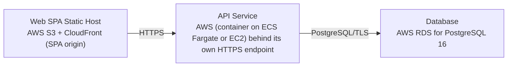

# Deployment Guide

> Maintained by QuorQ AI SDLC. Text between `sdlc:auto` markers is regenerated; anything outside them is yours and is kept.

<!-- sdlc:auto:start how-it-deploys -->
Pushes to `main` run `.github/workflows/deploy.yml`, which builds the API image (if there is a backend) and deploys the SPA to AWS Amplify. Commits touching only `docs/sdlc/**` don't deploy. Deployments can also be started from the platform's Deployment tab.
<!-- sdlc:auto:end how-it-deploys -->

<!-- sdlc:auto:start environments -->
| Name | Service | Runtime | Scaling | Environment |
|---|---|---|---|---|
| Web SPA Static Host | AWS S3 + CloudFront (SPA origin) | Static React 19 build | CDN edge cached | dev |
| API Service | AWS (container on ECS Fargate or EC2) behind its own HTTPS endpoint | FastAPI 0.115 on Python 3.12 (Uvicorn) | 1 task for dev, horizontally scalable | dev |
| Database | AWS RDS for PostgreSQL 16 | PostgreSQL 16 | Single instance for dev with automated backups | dev |
<!-- sdlc:auto:end environments -->

<!-- sdlc:auto:start live -->
**Frontend URL:** https://p6a8cfd4d09eb.dshared.amplifyapp.local

**Backend URL:** https://6a8cfd4d09eb.local.awsapprunner.local

**Database:** PostgreSQL · aisdlc_6a8cfd4d09eb

**Version:** 536dcb5dc27a

**Commit:** `536dcb5`

**Finished:** 2026-11-18
<!-- sdlc:auto:end live -->

<!-- sdlc:auto:start topology -->

<!-- sdlc:auto:end topology -->
